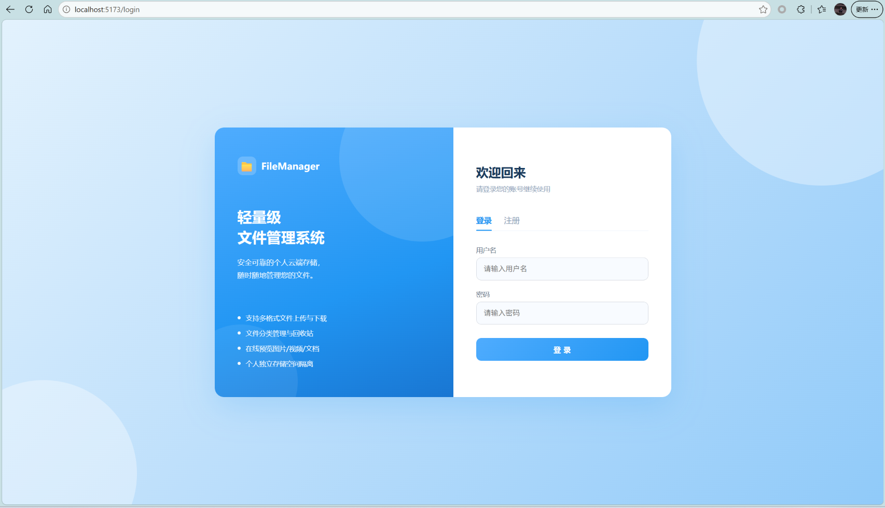
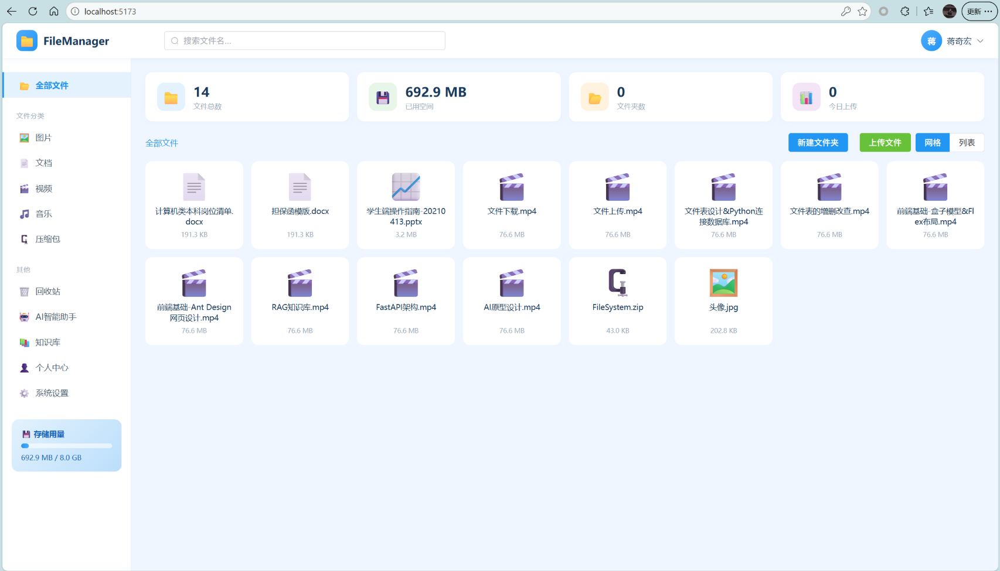
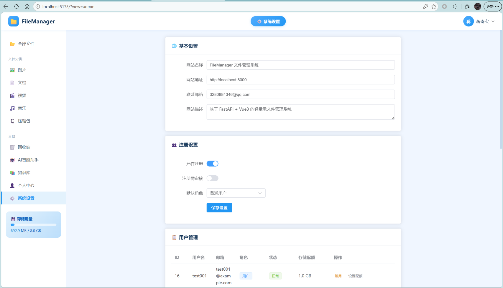
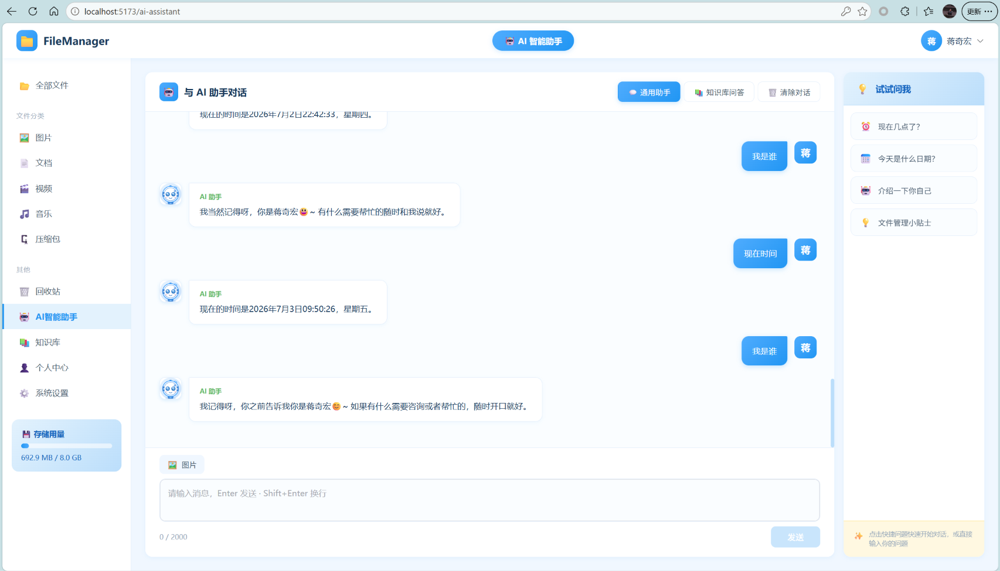
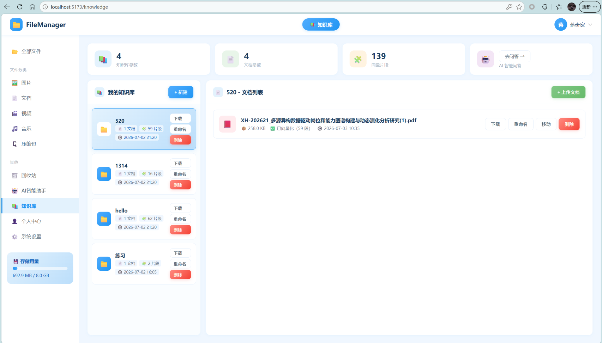

# FileManager 文件管理系统

基于 **FastAPI + Vue3 + MySQL** 的前后端分离轻量级文件管理系统，仿百度网盘布局，浅蓝色主题。
集成 AI 智能助手（多轮对话 / 图片识别）与知识库 RAG 问答，支持管理员后台、用户存储配额、回收站、文件分类检索等完整功能。


---

## 技术栈

| 层级 | 技术 |
|------|------|
| 后端 | Python 3.13 + FastAPI + SQLAlchemy 2.0 + PyMySQL + uvicorn |
| 前端 | Vue 3 + Vite 5 + Element Plus + Axios + Vue Router 4 + JSZip |
| 数据库 | MySQL 8.0+（InnoDB / utf8mb4） |
| 认证 | 自实现 JWT（SHA256 签名） |
| AI | 火山方舟（Volcano Ark）Doubao 系列模型（文本 / 视觉多模态 / Embedding） |
| 部署 | 后端 Dockerfile（python:3.13-slim）；前端构建产物由后端静态托管 |

---

## 功能清单

### 普通用户
- 注册 / 登录 / 修改密码 / 个人中心（查看存储配额与使用量）
- 文件夹：创建、列表、面包屑导航、重命名（递归更新子路径）、删除（软删除，内部文件一并入回收站）
- 文件：上传（单 / 多文件，单文件 100MB 上限，配额校验）、下载、在线预览、重命名、移动、软删除、批量删除 / 批量移动
- 回收站：文件列表、恢复、彻底删除、一键清空
- 分类浏览：全部 / 图片 / 文档 / 视频 / 音频 / 压缩包
- 关键字搜索、上传统计、存储用量概览
- **AI 通用助手**：多轮对话、Function Calling（获取当前时间）、图片上传识别
- **知识库问答**：跨所有知识库 RAG 问答，对话历史持久化，可一键清除

### 管理员（额外）
- 用户管理：用户列表、注册审核通过、禁用 / 启用账号、调整用户存储配额
- 系统设置：站点名称 / 地址 / 联系邮箱 / 描述、是否允许注册、注册是否需要审核、新用户默认角色

### 知识库模块
- 多知识库隔离（每个用户拥有独立知识库空间）
- 知识库创建 / 重命名 / 删除
- 文档上传：支持 `doc / docx / pdf / xls / xlsx / csv / txt`（单文件 20MB 上限），自动解析 → 分块 → 向量化 → 入库
- 检索：余弦相似度 + 关键词重叠混合打分，支持单库检索与跨库全局检索
- 单文档下载、知识库打包 ZIP 下载
- 向量优先调用火山方舟 Embedding API；未配置时自动降级为本地哈希向量（离线可用）

---

## 项目目录说明

```
FileSystem3/
├── backend/                      # 后端（Python FastAPI）
│   ├── app/
│   │   ├── main.py               # FastAPI 入口、生命周期、路由注册、前端 SPA 托管
│   │   ├── database.py           # SQLAlchemy 引擎 / 会话（支持环境变量）
│   │   ├── models.py             # 8 张表的 ORM 模型
│   │   ├── schemas.py            # Pydantic 请求校验模型
│   │   ├── utils.py              # JWT、密码哈希、统一响应、文件分类
│   │   ├── dependencies.py       # get_current_user / get_admin_user 鉴权依赖
│   │   ├── base_agent.py         # 火山方舟 API 封装（文本 / 视觉 / Embedding）
│   │   ├── chat_session.py       # 对话会话管理器（DB 持久化）
│   │   ├── kb_session.py         # 知识库文档解析 / 分块 / 向量化 / 检索 / RAG
│   │   └── routers/              # 路由：auth / folder / file / recycle / stats / settings / user / ai_router / kb_router
│   ├── file_manager.sql          # 数据库建表 + 初始数据脚本
│   ├── requirements.txt
│   ├── run.py                    # uvicorn 启动入口（0.0.0.0:8000）
│   └── Dockerfile
├── frontend/                     # 前端（Vue3 + Vite）
│   ├── src/
│   │   ├── views/                # Login / Home / AiChat / KnowledgeBase
│   │   ├── api/                  # auth / file / folder / kb / ai / settings 请求封装
│   │   ├── router/               # 路由 + 登录守卫
│   │   ├── stores/               # 用户状态
│   │   ├── utils/                # storage / format
│   │   └── assets/styles/        # 全局浅蓝色主题样式
│   ├── .env.development          # 开发环境 API 地址
│   ├── .env.production           # 生产环境 API 地址
│   ├── vite.config.js            # Vite 配置（dev proxy + build 输出到后端 static/dist）
│   └── package.json
└── README.md
```

> 运行时生成目录 `backend/static/`（用户上传文件 + 前端构建产物）、`backend/file_mgr/`（知识库文档）已在根 `.gitignore` 中排除，不会被提交。

---

## ⚠️ 个人配置替换说明（必须手动修改）

本项目在以下位置存在**需要使用者手动配置**的参数。

### 1. 数据库连接 — `backend/app/database.py`

支持环境变量，也可直接修改默认值：

```python
DB_USER = os.environ.get("DB_USER", "your_db_user")        # 你的 MySQL 用户名
DB_PWD  = os.environ.get("DB_PWD",  "your_db_password")     # 你的 MySQL 密码
DB_HOST = os.environ.get("DB_HOST", "127.0.0.1")
DB_PORT = os.environ.get("DB_PORT", "3306")
DB_NAME = os.environ.get("DB_NAME", "file_manager")
```

> 推荐使用环境变量启动，避免把密码写进代码：
> ```bash
> # Windows PowerShell
> $env:DB_USER="root"; $env:DB_PWD="你的密码"; python run.py
> # Linux / macOS
> DB_USER=root DB_PWD=你的密码 python run.py
> ```

### 2. 管理员账号 — `backend/app/main.py`

启动时若数据库中无管理员，会自动创建以下默认管理员。**请修改为你自己的账号**：

```python
ADMIN_USERNAME = "your_admin_username"     # 管理员用户名
ADMIN_PASSWORD = "your_admin_password"     # 管理员密码
ADMIN_EMAIL    = "your_email@example.com"  # 管理员邮箱
```

### 3. JWT 密钥 — `backend/app/utils.py`

```python
JWT_SECRET = "your_jwt_secret_key_here"   # 请替换为随机长字符串
JWT_EXPIRE_HOURS = 24
```

### 4. AI 模型配置 — `backend/app/base_agent.py`

AI 功能需要在[火山方舟控制台](https://www.volcengine.com/product/ark)申请。以下参数留空时 AI 功能会给出友好提示，不影响文件管理主功能：

```python
MODEL_ENDPOINT     = ""   # 文本模型推理接入点 ID（ep-xxxxxxxx）
VISION_ENDPOINT    = ""   # 视觉多模态模型接入点 ID（可选）
EMBEDDING_ENDPOINT = ""   # Embedding 模型接入点 ID（可选，知识库向量化用）
ARK_API_KEY        = ""   # API Key
```

### 5. 数据库初始数据 — `backend/file_manager.sql`

SQL 脚本中的初始管理员账号与联系邮箱需同步替换（注意密码需为对应明文的 SHA256 哈希值）：

```sql
INSERT INTO `user` (`username`, `password`, `email`, `role`, `status`)
VALUES ('your_admin_username', '<SHA256(your_admin_password)>', 'your_email@example.com', 'admin', 1);

INSERT INTO `system_setting` ...
('contact_email', 'your_email@example.com', '联系邮箱'),
```

> 可在 Python 中计算 SHA256：`hashlib.sha256("你的密码".encode()).hexdigest()`

### 6. 前端 API 地址 — `frontend/.env.development` / `.env.production`

```bash
# .env.development
VITE_API_BASE=http://localhost:8000

# .env.production（部署到服务器时改为你的后端域名，留空表示同源）
VITE_API_BASE=https://your-domain.com
```

---

## 环境准备

| 工具 | 推荐版本 |
|------|----------|
| Python | 3.10+（项目使用 3.13） |
| Node.js | 16+（推荐 18 LTS） |
| MySQL | 8.0+ |
| npm | 随 Node.js 安装 |

---

## 后端部署 & 启动步骤

```bash
# 1. 进入后端目录
cd backend

# 2. （推荐）创建并激活虚拟环境
python -m venv .venv
# Windows
.venv\Scripts\activate
# Linux / macOS
source .venv/bin/activate

# 3. 安装依赖
pip install -r requirements.txt

# 4. 配置数据库连接（见上方「个人配置替换说明」）

# 5. 启动后端服务
python run.py
```

启动成功后访问：`http://localhost:8000`（后端 API），`http://localhost:8000/docs`（Swagger 文档）。

> 如需 Docker 部署：
> ```bash
> docker build -t filemanager-backend ./backend
> docker run -p 8000:8000 -e DB_USER=root -e DB_PWD=你的密码 filemanager-backend
> ```

---

## 前端部署 & 启动步骤

```bash
# 1. 进入前端目录
cd frontend

# 2. 安装依赖
npm install

# 3. 开发模式启动（热更新）
npm run dev
```

开发服务器运行在 `http://localhost:5173`，已配置代理转发 API 到后端 `8000` 端口。

**生产构建：**

```bash
npm run build
```

构建产物自动输出到 `backend/static/dist`，由后端 `GET /` 直接托管，访问 `http://localhost:8000` 即可使用完整系统。

---

## 数据库初始化

### 方式一：命令行导入

```bash
mysql -u root -p < backend/file_manager.sql
```

该脚本会：
1. 删除并重建数据库 `file_manager`（⚠️ 全新安装用，已有数据请先备份）
2. 创建全部 8 张表（含外键、CHECK 约束、联合索引）
3. 插入默认管理员账号（需先按上方说明修改为你的账号）
4. 插入系统默认设置

### 方式二：Navicat / DBeaver 等图形工具

打开 `backend/file_manager.sql`，选择你的 MySQL 连接后执行即可。

### 表结构说明

| 表名 | 说明 |
|------|------|
| `user` | 用户账号、角色、存储配额 |
| `folder` | 文件夹（软删除） |
| `file` | 文件记录（软删除） |
| `system_setting` | 系统设置键值对 |
| `knowledge_base` | 知识库 |
| `kb_document` | 知识库文档 |
| `kb_chunk` | 文档向量化片段 |
| `chat_message` | AI 对话历史 |

---

## .gitignore 说明

项目根目录 `.gitignore` 已统一配置，排除以下内容（不会进入 Git 历史）：

- Python：`__pycache__/`、`.venv/`、`*.pyc` 等
- Node：`node_modules/`
- IDE / OS：`.idea/`、`.vscode/`、`.DS_Store`、`Thumbs.db`
- **运行时数据**：`backend/static/`（用户上传 + 前端构建产物）、`backend/file_mgr/`（知识库文档）、`backend/tmp_test/`
- 本地临时文件：`run_test.bat`、`test_output.txt`、`*.log`

> 此外 `backend/.gitignore` 与 `frontend/.gitignore` 保留了独立子项目的常用排除规则，双重保险。

---

## 项目截图

### 登录页


### 文件管理主界面


### 管理员后台


### AI 智能助手


### 知识库


---

## 开源说明

本项目仅用于学习展示。
- 前端构建产物、第三方依赖版权归原作者所有。
- 火山方舟等 AI 服务需自行申请 API Key，相关费用由使用者承担。
- 请勿将本项目用于非法用途。
